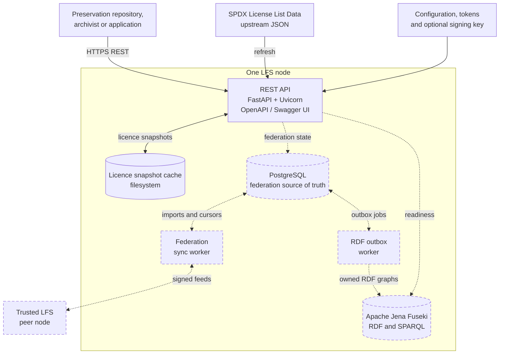

# System architecture

The License Facade Service (LFS) is a REST service with optional RDF and federation components. The diagram shows the full logical architecture implemented by this repository. Dashed components and connections are enabled only when their corresponding feature is configured.

## Component responsibilities

| Component | Responsibility | Preservation significance |
|---|---|---|
| REST API | Resolves licence identifiers, negotiates representations, exposes provenance and federation endpoints, and serves the OpenAPI interface. | Gives preservation workflows a stable integration boundary instead of binding them directly to a registry format. |
| SPDX License List Data | Supplies the upstream SPDX licence inventory and detail records. | Provides normalized identifiers and versioned source metadata for widely used licences. |
| Licence snapshot cache | Stores a locally active SPDX snapshot under `resources/data/licenses`. Refreshes are atomic and the last valid snapshot remains usable after an upstream failure. | Reduces dependence on live upstream availability and makes the data basis of a lookup easier to capture. |
| PostgreSQL | Stores federation identity, authoritative and imported records, append-only events, provenance, trust state, conflicts, decisions, cursors, and RDF outbox jobs. | It is the operational source of truth for federated records and audit history. |
| Federation sync worker | Polls explicitly trusted peer nodes, verifies their signed feeds, and commits imported records page by page. | Maintains resumable, attributable copies without presenting imported material as locally authoritative. |
| RDF outbox worker | Claims durable jobs from PostgreSQL and publishes deterministic LFS-owned graphs. Failed jobs are retried or dead-lettered. | Keeps registry resolution available if the semantic index is temporarily unavailable. |
| Apache Jena Fuseki | Stores RDF graphs and provides SPARQL access. It is an interoperability index, not the federation source of truth. | Supports linked-data discovery and semantic queries while preserving PostgreSQL provenance and decision history. |
| Configuration and secrets | Provides service settings, administrator and curator tokens, peer policy, and the node's Ed25519 private key. | Stable node identity and protected signing material are necessary to verify the origin of federated evidence. |

## What Docker Compose starts

The profiles in `docker-compose.yaml` are examples rather than a single all-components production topology:

- `app` starts one LFS REST API container and one Fuseki container. The API uses the mounted `resources` directory for its licence snapshot. It does not start PostgreSQL or federation workers.
- `federation-demo` starts two LFS nodes, one PostgreSQL database for each node, and a synchronization worker for node B. Fuseki is explicitly disabled in this demonstration profile.
- A full federated deployment requires PostgreSQL and a signing key for each node. The RDF outbox worker and Fuseki are separate runtime components when RDF publication is required.

The current Compose file does not define a reverse proxy, load balancer, external identity provider, or observability stack. Those may be added by a deployment platform, but they are not part of the implementation documented here.

## Preservation boundary

LFS resolves and exchanges licence information, but the archive remains responsible for retaining the response bytes, media type, retrieval time, source node, response headers, digest, and any curator decision alongside the preserved object. Neither PostgreSQL nor Fuseki replaces evidence stored in an archival information package.
