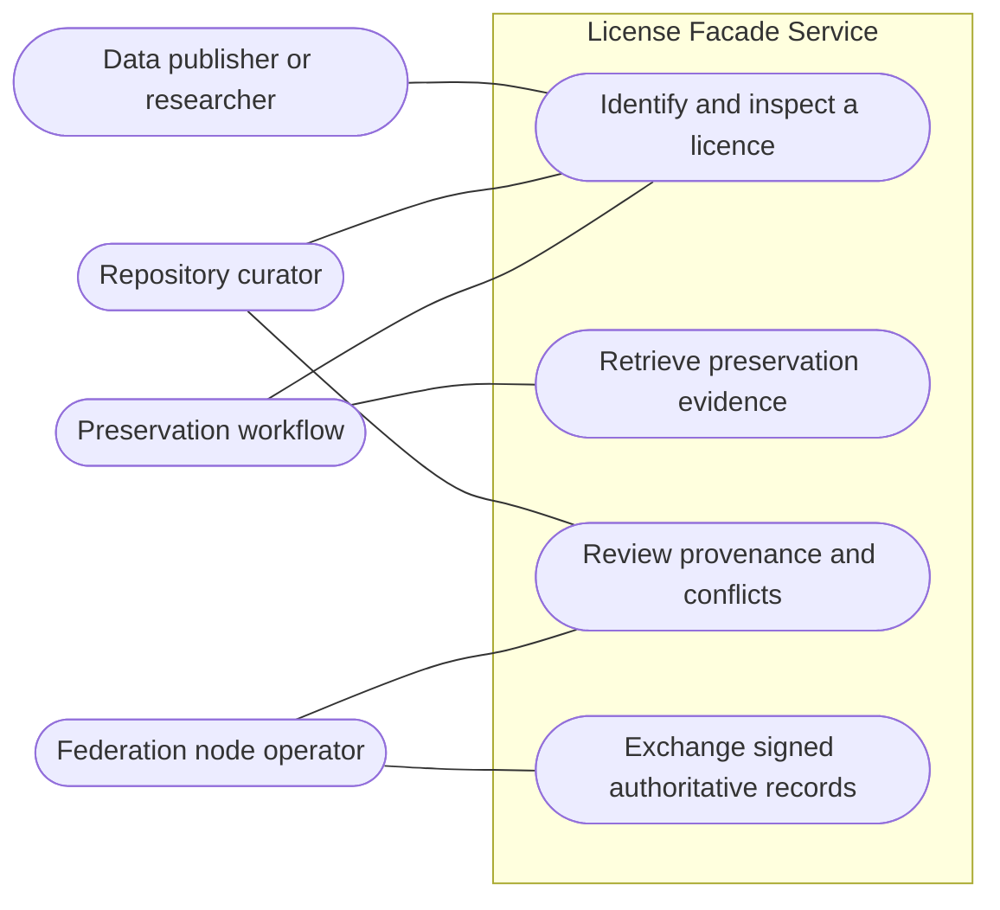

# Actors and use cases

LFS sits between licence registries, repositories, preservation systems, and people responsible for rights metadata. Its preservation value comes from keeping identity, representation availability, authority, and provenance separate. The service supplies evidence; the archive records how it used that evidence.

## Actors

| Actor | Preservation goal | Typical interaction |
|---|---|---|
| Data publisher or researcher | Cite a licence unambiguously and inspect the forms available for people and machines. | Public licence endpoints or a repository deposit interface that calls LFS. |
| Repository curator | Review rights metadata and make accountable decisions when records are incomplete or conflicted. | Public provenance endpoints and protected conflict APIs. |
| Preservation workflow | Normalize licence references during ingest and retain verifiable evidence in the information package. | Automated JSON, JSON-LD, or RDF requests. |
| Federation node operator | Maintain a trustworthy local authority and exchange records with explicitly trusted peers. | Protected administration APIs, workers, PostgreSQL, and Fuseki outbox tooling. |

## Data publisher or researcher

### P1. Cite an unambiguous licence

- **Goal:** replace an ambiguous label such as “CC BY” with a resolvable identifier.
- **Main flow:** the publisher searches or looks up a licence, checks its name and deprecation state, and records the returned LFS URI in dataset metadata.
- **Alternative:** when no suitable record exists, the publisher asks the responsible curator or node operator to establish an authoritative record instead of inventing a local string.
- **Outcome:** the dataset points to a stable identity that a later consumer can resolve.
- **Related requirements:** LFS-REQ-1-01, LFS-REQ-2-01, LFS-REQ-4-01.

### P2. Inspect available licence forms

- **Goal:** find a human-readable text, legal code, or machine-readable rights expression.
- **Main flow:** the publisher follows `_links` or an explicit representation route and checks `representationStatus` and `conformance`.
- **Alternative:** the requested representation returns `404`; the publisher records that gap and selects an available form without treating it as equivalent.
- **Outcome:** the publisher knows which representation was used and which expected forms were unavailable.
- **Related requirements:** LFS-REQ-2-04, LFS-REQ-3-01, LFS-REQ-4-01.

## Repository curator

### C1. Review licence evidence during appraisal

- **Goal:** decide whether the rights metadata supplied with a deposit is sufficiently clear for preservation and access planning.
- **Main flow:** the curator compares the supplied identifier with the resolved metadata, source references, representation status, and provenance. The curator records any correction as part of the repository's appraisal record.
- **Alternative:** missing mandatory representations or an unknown identifier trigger a documented query to the depositor rather than silent normalization.
- **Outcome:** the repository retains the submitted value, the resolved value, and the curator's decision.

### C2. Decide a federation conflict

- **Goal:** resolve competing imported candidates without erasing the evidence that caused the conflict.
- **Precondition:** federation is enabled and the curator has a curator or administrator token.
- **Main flow:** the curator inspects the candidates and their source trust state, then appends a decision with the current `expectedVersion` and a rationale.
- **Alternative:** a stale version returns `409`; the curator reloads the conflict before deciding again. A later reversal appends another event.
- **Outcome:** resolution can proceed according to an auditable, reversible decision history.

## Preservation workflow

### W1. Normalize a licence reference during ingest

- **Goal:** turn an identifier from deposit metadata into a canonical reference without losing the original value.
- **Main flow:** the workflow stores the submitted identifier, resolves it through LFS, stores the canonical ID or URI, and records the HTTP status and response digest.
- **Alternative:** `404`, `409`, `410`, and `503` become distinct workflow states for manual review, tombstone handling, or retry.
- **Outcome:** the archival package contains both the original assertion and the normalization evidence.

### W2. Preserve a machine-readable representation

- **Goal:** retain licence information in a form that future systems can parse.
- **Main flow:** the workflow requests JSON-LD, Turtle, or RDF/XML, validates the media type, stores the exact bytes, and records the retrieval time and digest.
- **Alternative:** if `/machine` is unavailable, the workflow stores the general metadata representation and the explicit conformance failure. It does not relabel SPDX JSON as a rights-expression encoding.
- **Outcome:** the information package contains a parseable representation with enough context to interpret its origin.

## Federation node operator

### O1. Enroll and synchronize a trusted peer

- **Goal:** import records from another authority without automatic or anonymous trust.
- **Main flow:** the operator verifies the peer's node identity and key fingerprint out of band, enrolls it with pinned values, runs synchronization, and monitors accepted and rejected events.
- **Alternative:** identity, signature, digest, network-policy, or schema failures reject the affected data and leave the last committed cursor intact.
- **Outcome:** imported records retain source provenance and remain non-authoritative on the receiving node.

### O2. Publish and maintain an authoritative record

- **Goal:** make a locally governed licence record discoverable to trusted peers.
- **Main flow:** the operator publishes a new local version, verifies that it appears in the catalog and signed change feed, and monitors the RDF outbox until its graph state succeeds.
- **Alternative:** Fuseki failure moves the RDF job through retry or dead-letter states while PostgreSQL remains available for resolution.
- **Outcome:** the node exposes a signed, append-only publication history without re-exporting imported records as its own.
